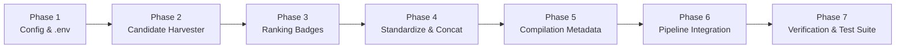

# Top 5 Ranking Compilation Bot: Architecture & Implementation Plan

## 📌 Executive Summary
Transform the existing single-clip Reddit-to-Shorts bot into a **Top 5 Ranking Countdown Compilation Bot** ("Top 5 Fails", "Top 5 Instant Regrets", "Top 5 Unexpected Moments"). Countdown compilations represent one of the highest-retention formats on YouTube Shorts because the ranking badge (#5 → #1) psychologically incentivizes viewers to watch until the #1 climax.

---

## 🧭 Core Architectural Principles & Golden Rules

### 1. Candidate Pool Ingestion (The "Harvest & Pick" Strategy)
* **Never download linearly:** Avoid attempting to fetch clip 1, then clip 2, etc., which compounds failure risk.
* **Metadata in RAM:** Fetch a batch of 25–40 candidate post metadatas from Reddit via a single lightweight API/JSON request (~50 KB in memory, ~0.3s).
* **Lazy Stream & Discard:** Iterate through candidates in RAM and download **one video at a time** onto disk.
* **Immediate Stop:** As soon as 5 eligible clips pass duration, audio, and safety checks, stop downloading. Total disk usage remains minimal (~30–40 MB).

### 2. The 60-Second Shorts Duration Ceiling
YouTube Shorts strictly enforces a maximum duration of **60.0 seconds** (videos $\ge 60.01$s are published as standard horizontal videos, missing the Shorts algorithmic shelf).
* **Per-Clip Target:** 6 to 10 seconds per clip ($5 \times 9\text{s} = 45\text{s}$).
* **Ingestion Filter:**
  * `MIN_CLIP_DURATION = 4.0` seconds
  * `MAX_CLIP_DURATION = 11.0` seconds
* **Compilation Cap:** `COMPILATION_MAX_TOTAL_DURATION = 58.0` seconds. If the 5th clip pushes total runtime over 58s, skip it and select a shorter candidate.

### 3. Standardize Before Concat (Zero Desync & Stutter)
Concatenating clips with differing resolutions, aspect ratios, framerates, or audio sample rates causes FFmpeg desync and stutter.
* Every clip is pre-processed into a standardized intermediate format before stitching:
  * **Resolution:** Exactly `1080x1920` (9:16 vertical).
  * **Layout:** Centered original video with `boxblur=30:5` blurred background canvas for landscape/square videos.
  * **Framerate:** Fixed `60.0 FPS` constant framerate (`-r 60 -vsync cfr`).
  * **Audio:** Normalized `48,000 Hz, 2-channel stereo AAC, 192 kbps`.
* **Instant Stitch:** With identical parameters, FFmpeg’s `concat` demuxer merges all 5 clips in **under 2 seconds with 0% audio desync**.

### 4. Countdown Ranking & Climax Sorting (#5 ➔ #1)
* **Climax Order:** The 5 approved clips are sorted in ascending order of their Reddit upvote score:
  * Clip 1: **#5** (Strong opening hook)
  * Clip 2: **#4**
  * Clip 3: **#3**
  * Clip 4: **#2**
  * Clip 5: **#1** (Highest Reddit upvotes / most viral climax)
* **Visual Badge Overlay:** High-contrast PIL badges burned into each clip:
  * `#5`, `#4`, `#3`, `#2` (Vibrant White / Orange / Neon Red pill badges)
  * `#1 🏆` (Special Gold / Red Climax Badge with "WAIT FOR IT" or "WINNER")

---

## ⚙️ Technical Considerations & Constraints

| Factor | Constraint | Mitigation |
| :--- | :--- | :--- |
| **YouTube Shorts Duration** | Hard ceiling: $< 60$ seconds | Accumulated duration limiter capped at 58.0 seconds total. |
| **Silent Clips** | Reddit video tracks sometimes lack audio | Inspect audio stream with `ffprobe`. Discard silent clips or overlay fallback audio. |
| **Deleted / Private Posts** | CDN links may 404 or expire | Graceful exception handling in download loop; skip candidate and try next. |
| **CI / GitHub Actions Limits** | 60 min job timeout, ephemeral disk | Process runtime is $\sim 90$s total; disk footprint is $< 40$ MB. |
| **Content Safety** | 4-stage policy compliance | Apply Stage 1 safety check to every candidate clip before accepting into pool. |
| **Deduplication State** | Never reuse clips in future videos | Atomically append all 5 used Reddit IDs into `processed_reddit_posts.json`. |

---

## 🛠️ Step-by-Step Implementation Roadmap



### Phase 1: Configuration & Settings (`config.py` & `.env`)
* Introduce configuration options:
  * `COMPILATION_MODE = True`
  * `COMPILATION_CLIP_COUNT = 5`
  * `COMPILATION_MIN_CLIP_DURATION = 4.0`
  * `COMPILATION_MAX_CLIP_DURATION = 11.0`
  * `COMPILATION_MAX_TOTAL_DURATION = 58.0`
  * `COMPILATION_BADGE_STYLE = "top_left"`

### Phase 2: Candidate Pool Harvester (`src/reddit/client.py`)
* Create `get_compilation_candidate_pool(target_count=5)`:
  * Query 25–40 posts via existing provider chain (Anonymous JSON / PRAW).
  * Filter out processed IDs, low scores, stickied, or text posts in RAM.
  * Download candidate videos one-by-one.
  * Probe duration ($4.0\text{s} \le d \le 11.0\text{s}$) and verify audio track.
  * Run Content Safety Stage 1 check.
  * Stop when 5 valid clips are collected or total duration reaches $\le 58\text{s}$.
  * Sort clips #5 to #1 by Reddit score.

### Phase 3: Badge Generation (`src/video/overlay.py`)
* Create `generate_ranking_badge(rank: int, max_rank: int = 5) -> Path`:
  * PIL rendering of aesthetic curved pill badge (`#5`, `#4`, `#3`, `#2`, `#1`).
  * High-visibility dropshadow and border for readability over any video background.
  * Optional: Hook title banner on top of the screen.

### Phase 4: Standardization & Concat Engine (`src/video/renderer.py`)
* Create `standardize_clip(clip_path, badge_path, output_path)`:
  * 1080x1920 60fps CFR encoding with blurred background padding.
  * 48kHz stereo AAC audio normalization.
  * Overlay rank badge at top-left safe zone ($x=60, y=140$).
* Create `concat_standardized_clips(clip_paths: List[Path], output_path: Path)`:
  * Uses FFmpeg concat demuxer (`-f concat -safe 0 -c copy`) for instant loss-less stitching.

### Phase 5: Dynamic Viral Metadata (`src/upload/metadata.py`)
* Create `generate_compilation_metadata(posts: List[RedditPost])`:
  * Click-worthy countdown titles (e.g., *"Top 5 What Could Go Wrong Moments (#1 is PAINFUL) 💀"*).
  * Timestamps in description:
    ```text
    Rank them in the comments! 👇
    0:00 - #5
    0:08 - #4
    0:17 - #3
    0:27 - #2
    0:38 - #1 (Grand Finale)
    
    #shorts #whatcouldgowrong #instantregret #fails
    ```

### Phase 6: Master Pipeline Integration (`run_pipeline.py`)
* Support `--compilation` CLI flag and `COMPILATION_MODE=True` from `.env`.
* If compilation mode is active:
  * Harvest 5 clips $\rightarrow$ Standardize & Badge $\rightarrow$ Stitch $\rightarrow$ Upload $\rightarrow$ Save all 5 IDs to DB $\rightarrow$ Clean temp files.

### Phase 7: Verification & Testing (`test_compilation_mode.py`)
* Create an isolated end-to-end integration test that downloads sample clips, standardizes them with badges, verifies duration $\le 58\text{s}$, and produces `data/output/test_compilation_final.mp4`.

---

## 🔗 Repository Configuration
* **Git Remote URL:** Linked to `https://github.com/Abrar-Husain-870/wcgw-top-5-ranking-compilation.git`
* **Local Branch:** `main`
* **Ignored Secrets:** `.env` and `data/` directories are protected via `.gitignore`.
